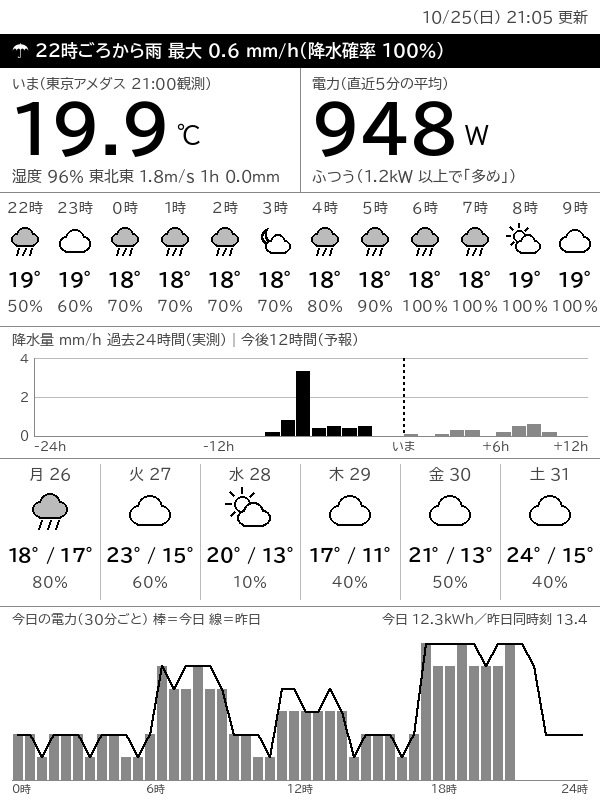

# kindash

古い Kindle 3（Kindle Keyboard 3G、脱獄済み）を、天気と電力の1画面の表示機にする。
画面は Cube J1（[cubeJ1](https://github.com/nekomami-create/cubeJ1) で電力モニタにしたもの）が描き、
Kindle は15分ごとに取ってきて全画面に出すだけ。

```
気象庁・Open-Meteo --HTTPS(curl)--> Cube J1 --HTTP:8090--> Kindle 3
                                    ├ kindash.py  15分ごとに描く   └ kindash.sh  15分ごとに取って
meter_hub (127.0.0.1:8080) -------->│  600x800・8bit グレーの PNG     eips -g で表示
                                    └ /screen.png で配る
```



（天気は東京駅で取った実データ、電力は作り物の見本データで描いたもの）

## 画面の中身（上から）

1. 更新時刻
2. 雨の帯：3時間以内に雨（0.5mm/h 以上か降水確率60%以上）が始まるときだけ白黒反転。
   先12時間までで区切る。なければ「3時間以内に雨の予報はありません」
3. いま：左に最寄りアメダスの気温・湿度・風・1時間降水量、右に電力の直近5分の平均
4. 12時間予報：天気マーク（夜は月）・気温・降水確率（Open-Meteo、気象庁のモデルを優先）
5. 降水量：過去24時間はアメダスの実測、今後12時間は予報。縦軸は 0〜3mm/h を基本に広げる
6. 週間予報：明日から6日（気象庁の府県予報・週間予報）
7. 今日の電力：30分ごとの棒（今日）と線（昨日）、今日と昨日同時刻の合計

どの取得が失敗しても、その段に「取得できません」と出るだけで残りは描く。

## ファイル

| パス | 中身 |
|---|---|
| `cube/kindash.py` | Cube で動く本体（Python 2.7 の標準ライブラリだけ。PC の Python 3 でも動く） |
| `cube/kindash_assets.json` / `.bin` | 文字と天気マークの素材。`tools/build_assets.py` が作る |
| `cube/cacert.pem` | curl 公式の CA 一覧。Cube の CA が古く Open-Meteo を検証できないため |
| `cube/kindash.rc` | Cube の init サービス定義 |
| `kindle/kindash.sh` | Kindle 側。`start` / `stop` / `status` |
| `kindle/kindash.init` | Kindle の起動時に `kindash.sh start` を呼ぶ（`/etc/init.d/kindash`） |
| `tools/build_assets.py` | PC の Pillow で素材を作る |
| `samples/` | 見本データ。天気は東京駅で取った実データ、電力（`cube_*.json`）は作り物 |
| `mock/render_mock.py` / `screen_mock.png` | 最初の画面案 |

### リポジトリに入れない設定

家の場所と LAN の構成に結びつくので、次の2つは `.gitignore` で外してある。

`cube/kindash_config.json`（Cube の `/data/local/kindash/` に置く。無ければ東京駅）:

```json
{"lat": 35.6812, "lon": 139.7671, "jma_office": "130000", "jma_area": "130010", "jma_temp_station": "44132"}
```

- `lat` / `lon`: 地点。アメダスは、気温を測っている観測所のうち一番近い所を自動で選ぶ
- `jma_office` / `jma_area`: 気象庁の府県予報区と一次細分区（週間予報の天気と降水確率）
- `jma_temp_station`: 週間予報の気温を出す地点

`kindle/kindash.conf`（Kindle の `/mnt/us/kindash/` に置く。無ければ `start` しない）:

```sh
URL="http://<CubeのIP>:8090/screen.png"
```

## Cube 側

Cube の Python 2.7 には ssl も zlib も画像ライブラリもないので:

- HTTPS は `/system/bin/curl`（OpenSSL 1.1.1b）に任せる
- 文字はフォントを描けないので、使う字を使う大きさで PC で板にしておき、貼るだけ。
  `kindash.py` の文言を変えたら `python tools/build_assets.py` を走らせ直す
  （字はソースから拾い、大きさは `FONT_SPECS` / `ICON_SIZES` を読む。アメダス観測所名の字は
  全観測所ぶんを入れるので、地点を変えても欠けない。フォントは BIZ UDPゴシック）
- PNG は無圧縮の deflate で書く。Kindle の `eips` は 8bit しか受け付けない（4bit は「8bit only」で拒否）

実測は、取得 5〜12 秒、描画と PNG で約 1.2 秒、480KB。

```
GET /screen.png   いちばん新しい画面（10分より古ければ描き直してから返す）
GET /render       今すぐ描き直す
GET /healthz      "ok"
```

15分の区切り＋60秒に描く。取れないものがあれば2分後に描き直す（起動直後は DNS も
meter_hub もまだのことがある）。ログは `/data/local/kindash/kindash.log`。

### 入れ方

```sh
adb connect <CubeのIP>:5555
adb shell mkdir -p /data/local/kindash
adb push cube/kindash.py cube/kindash_assets.json cube/kindash_assets.bin cube/cacert.pem cube/kindash_config.json /data/local/kindash/
adb push cube/kindash.rc /data/local/tmp/
adb shell mount -o rw,remount /
adb shell cp /data/local/tmp/kindash.rc /system/etc/init/kindash.rc
adb shell chmod 644 /system/etc/init/kindash.rc      # 0666 だと init が読まない
adb shell mount -o ro,remount /
adb reboot                                           # 新しい rc は再起動で読まれる
```

ペアリング AP 側の 8090 は、cubeJ1 のファイアウォール設定（`POLICY` の `p2p+:8090`）で塞いである。

入れ替えだけなら `adb push` のあと `adb shell stop kindash; adb shell start kindash`。
**`ps` には引数が出ない**ので、`python` のプロセスがどれかは `/proc/<pid>/cmdline` で見分ける
（meter_hub なども同じ `python`）。

### PC で試す

```sh
KINDASH_SAMPLES=samples KINDASH_STATE=samples KINDASH_NOW=1792929900 python cube/kindash.py --once out.png
```

## Kindle 側

### 前提（脱獄と SSH）

- 本体は Kindle Keyboard 3G 国際版（ファイル名の機種は `k3gb`）、FW 3.4.2
- 脱獄: NiLuJe の `kindle-jailbreak-0.13.N`（MobileRead の snapshots）の
  `Update_jailbreak_0.13.N_k3gb_install.bin` を直下に置いて Update Your Kindle
- SSH: **snapshots 版の USBNetwork は先頭が `SP01`（KUAL の MRPI 専用）で、Update Your Kindle では入らない。**
  MobileRead の [legacy スレッド](https://www.mobileread.com/forums/showthread.php?t=88004) の添付
  `kindle-usbnetwork-0.57.N-k3.zip` の `Update_usbnetwork_0.57.N_k3gb_install.bin`（先頭 `FC02`）を使う
- `usbnet/etc/config` で `K3_WIFI="true"`・`K3_WIFI_SSHD_ONLY="true"`、`usbnet/etc/authorized_keys` に
  PC の公開鍵（RSA。古い dropbear は ed25519 を読めない）。`usbnet/auto` を置くと起動時に SSH も上がる
- Wi-Fi: Wi-Fi 6 のルーターで 2.4GHz をチャンネル自動にしていたら、Kindle の一覧から
  ときどき消えた。チャンネルを固定（1/6/11）したら直った

```sh
ssh -i <鍵> -o HostKeyAlgorithms=+ssh-rsa -o PubkeyAcceptedAlgorithms=+ssh-rsa root@<KindleのIP>
```

### 入れ方

```sh
ssh ... 'mkdir -p /mnt/us/kindash && cat > /mnt/us/kindash/kindash.sh' < kindle/kindash.sh
ssh ... 'cat > /mnt/us/kindash/kindash.conf' < kindle/kindash.conf
ssh ... 'cat > /tmp/kindash.init && mntroot rw && cp /tmp/kindash.init /etc/init.d/kindash \
  && chmod 755 /etc/init.d/kindash && ln -sf ../init.d/kindash /etc/rc5.d/S99kindash; mntroot ro' < kindle/kindash.init
ssh ... 'sh /mnt/us/kindash/kindash.sh start'
```

- `start` で Kindle の標準画面（framework）を止め、スクリーンセーバーを抑えて、
  15分の区切り＋120秒ごとに取って表示する。4回に1回（1時間ごと）は全面を点滅させて残像を消す
- **HOME キーで普段の Kindle に戻る**。それ以外のキーで今すぐ更新
- 起動時は90秒待ってから始まる。`/mnt/us/kindash/DISABLE` を置くと自動では始まらない
- 取れなかったときは前の画面を残し、右下に `! fetch failed HH:MM` と出す
- ログは `/mnt/us/kindash/kindash.log`

Kindle 3 の busybox は 1.7 で、`nohup`・`grep -E`・`date -d` が無い。非対話の SSH では
`PATH` に `/usr/sbin` が無いので `eips` などはフルパスで呼ぶ。表示の時計（タイムゾーン）はずれているが
unix 時間は正しいので、時刻の計算は `date +%s` から日本時間を出している。

## 未確認

- キー操作（HOME で戻る、ほかのキーで更新）を、こちらから押して確かめてはいない
  （ログには、キーでの更新が残っている）
- 電池が弱い。常時給電で使う前提。完全に劣化したら互換電池（GP-S10-346392-0100）に交換する
- 1時間予報で、天気マークが雲なのに降水確率が高いことがある。
  天気は気象庁のモデル、降水確率は best_match から取るため（気象庁のモデルは降水確率を出さない）
